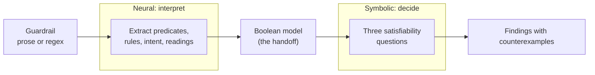

## When a guardrail misbehaves, where is the bug?

A guardrail is a small program written in a language nobody compiles. It might be
five sentences in a system prompt, or a handful of regexes in a config file. It
pretty much says what an agent may and may not do.

And like any program, it has bugs. The symptoms are familiar:

- It blocks something perfectly harmless.
- Two rules disagree about the same request.
- A rule can be read two ways, and the two readings behave differently.

When code misbehaves, we ask a _fault localization_ question: which statement is
responsible? That question has decades of tooling behind it. For a guardrail, we
mostly have a shrug and a pile of test prompts, friendly and adversarial alike.

I'll argue that this problem is a clean example of something that needs both a
language model and a solver, each doing a different job. This post is about that
division of labor: what each half is good for, what it cannot be trusted with,
and where the handoff between them should sit.

> Let a language model read the policy, but let a solver decide whether it is broken, and make the solver hand back a counterexample.

People call this shape _neuro-symbolic_: a neural component where the problem is
language, and a symbolic component where the problem is proof. The phrase is easy to
say and easy to over-claim, so I'll be concrete about what it buys here.

## Why can't a language model just tell me?

The obvious first attempt is to hand the policy to an LLM and ask, "Is anything
wrong with these rules?"

Unsurprisingly, the LLM will happily answer. It might say that rule 1 "seems too
broad and could block harmless requests," or that rules 2 and 3 "may conflict in
edge cases." Both are plausible, and both are close to unfalsifiable. Which
harmless requests, you might ask? Which edge cases? Do the claims hold for every
phrasing, or just the one the model happened to imagine? Ask again five minutes
later and you may get a different list.

LLMs are great at reading a policy and raising plausible concerns. They are not
good at being exhaustive, and they can't hand you a concrete input that shows
the problem is real, a counterexample. Fault localization needs both: some
assurance that nothing was missed, and an input that proves each finding.

## Why can't a solver just tell me?

The opposite attempt is to use formal methods and reach for a solver. SAT
solvers are excellent at this kind of question: given a set of rules, does some
input make two of them disagree?

The catch is that a solver needs the rules as logic, and your guardrail is
prose. A solver can't read "block personalized investment recommendations for
minors and first-time investors." It doesn't know what "personalized" means, or
whether "minors and first-time investors" means both groups or either one. A
solver is exact but blind to language, so until someone translates the prose
into logic, there is nothing for it to check.

## So what does each half do?

Each half is strong exactly where the other is weak, so it's clear who should do
what. Side by side:

| | Neural half | Symbolic half |
| --- | --- | --- |
| Works on | Prose: rules, intent, examples | Logic: each rule as an AND/OR condition over yes/no predicates |
| Job | Read and interpret; propose readings | Decide satisfiability; return a counterexample |
| Strength | Handles language: "substantial," "personalized" | Sound and complete relative to the model: if a fault exists in it, the solver finds it |
| Not trusted for | Exactness, or giving the same answer twice | Anything outside the facts it was given |

The one rule that holds the design together is a restriction on the neural half:

> The language model proposes an interpretation. It never issues the verdict.

The language model does not say "this rule is over-strict." It supplies a
Boolean model of the policy, and a decision procedure it does not control turns that
model into a conclusion. For example, that procedure can ask whether any
request $$x$$ is both safe and blocked: $$\mathrm{safe}(x) \wedge
\mathrm{blocked}(x)$$. The Boolean model is the handoff, and everything else in
this post is about how to make it narrow enough to inspect.

Here is what it looks like end to end:



## What counts as a fault in a guardrail?

Before the handoff, let's look at what the symbolic half is actually being asked
to find. Here is a small financial-information policy, with four rules in plain English:

1. Block any response containing the words _buy_, _sell_, or _invest_.
2. Allow general financial education that does not recommend a specific transaction.
3. Block instructions explaining how to trade a specific investment.
4. Block personalized investment recommendations for minors and first-time investors.

Three kinds of fault hide in there.

**Over-strict.** Rule 1 blocks "Google will invest up to $2 billion." That is
neutral reporting about someone else's action, and the policy's own intent says it
should be allowed. The rule is broader than the policy it serves.

**Contradiction.** Rule 2 allows "how to" education and rule 3 blocks instructions
to trade. For a request like "explain how to trade shares," both apply, and they
demand opposite outcomes. Nothing in the policy says which wins.

**Ambiguity.** Rule 4 says "minors and first-time investors." Does that mean
either group, or only people who are both? The two readings handle a 30-year-old
first-time investor differently.

These are not the same kind of problem. Over-strictness is a mismatch between a
rule and the intent behind it. Contradiction is a conflict between two rules.
Ambiguity is a conflict between two readings of one rule. Localizing each one
takes a different approach, and that difference shapes what the neural half must
produce.

## The handoff: a model a human can audit

The handoff is the most important design decision, because it is the only place
where the neural half's output turns into something the symbolic half trusts.

I want that object to be narrow, and I want a person to be able to read it. So
the language model reads the rules, the system prompt, and any labeled examples,
and returns a small Boolean model:

- **Predicates**: named yes/no facts about a request, each with a precise
  description, such as `recommends_transaction` or `is_neutral_report`.
- **Rule conditions**: for each rule, a decision (allow or block) and a condition
  over predicates, written in disjunctive normal form. The outer list is OR, each
  inner list is AND.
- **A safe condition**: the set of requests that are legitimate, described
  _independently_ of whether any written rule blocks them.
- **Exclusions**: groups of mutually exclusive predicates, of which at most one can
  be true.
- **Ambiguities**: for each unclear rule, two distinct, plausible formalizations.

In symbols, with predicates $$P=\{p_1,\dots,p_n\}$$, each rule $$r$$ has a decision
$$d_r\in\{\mathrm{allow},\mathrm{block}\}$$ and a condition

$$
C_r=\bigvee_{i}\bigwedge_{j}\ell_{ij},
$$

where each literal $$\ell_{ij}$$ is a predicate or its negation. The safe condition
$$S$$ has the same shape. The exclusions form a set $$E$$ of groups of predicates,
and they become a global constraint: no two predicates $$p,q$$ in the same group
$$e$$ can both be true,

$$
\Gamma=\bigwedge_{\{p,q\}\subseteq e,\ e\in E}\neg(p\wedge q).
$$

That is the whole object, small enough to read in one sitting. Three properties
of it are deliberate.

**It is descriptive.** Every predicate carries a sentence saying what it means. If
the language model mistranslates a rule, the mistake is visible as a predicate you can
disagree with, not buried in a score.

**It is shaped by the questions.** The safe condition and the paired readings are in
the Boolean model because the symbolic half needs them to ask over-strictness and ambiguity
questions. The neural half is told what the symbolic half will ask. That is the
reverse of the usual "extract everything and see."

**It is the trust boundary, and I should say so plainly.**

> The proofs are about the extracted model, not about the original prose.

If the language model mistranslates a rule, the solver will faithfully prove things
about the wrong model. The design does not remove that risk. It makes the risk
inspectable and keeps it confined to one place.

## Three faults, three satisfiability questions

Once the policy is a Boolean model, each fault becomes a question of the form
_does an assignment exist such that...?_ Below, $$x$$ ranges over assignments of
true or false to the predicates in $$P$$, which stand for the possible requests as
the model sees them, and $$C(x)$$ is the value of a condition $$C$$ under $$x$$.

**Over-strict.** A blocking rule $$r$$ is over-strict if there is some legitimate
request that it blocks. This is the safe-and-blocked question from earlier, asked
about one rule at a time:

$$
\exists x:\ \Gamma(x)\wedge S(x)\wedge C_r(x).
$$

**Contradiction.** Two rules $$r$$ and $$r'$$ with different decisions contradict
each other if some request satisfies both conditions:

$$
\exists x:\ \Gamma(x)\wedge C_r(x)\wedge C_{r'}(x)\qquad\text{for } d_r\neq d_{r'}.
$$

**Ambiguity.** Suppose a rule has two readings $$A$$ and $$B$$ with conditions
$$C_A,C_B$$ and decisions $$d_A,d_B$$. The readings diverge on a request when

$$
\Delta=\begin{cases}
C_A\oplus C_B & \text{if } d_A=d_B,\\
C_A\vee C_B & \text{if } d_A\neq d_B,
\end{cases}
$$

is satisfiable. The case split is worth a moment. If both readings reach the same
decision, they disagree exactly when one applies and the other does not, which is
an exclusive-or. Asking whether it is satisfiable is an equivalence check on the
two formalizations. If they reach different decisions, then any request that either
reading covers is already a disagreement: if both apply they conflict, and if only
one applies, the other leaves the request undecided.

In each case the solver answers SAT or UNSAT. If the formula is UNSAT, no request
can trigger that fault, at least within the extracted Boolean model. If it is
SAT, the solver returns a satisfying assignment, which we call a **witness**: a
concrete class of requests that demonstrates the fault. The witness becomes the
counterexample in the finding, which is why a finding is evidence and not an
opinion.

Here is a tiny model, loosely based on rules 1 and 2 above. I wrote it by hand,
the way an extractor would return it, with two rules and one exclusion:

| Predicate | Meaning |
| --- | --- |
| `mentions_invest_word` | the response contains buy, sell, or invest |
| `recommends_transaction` | the response recommends a specific transaction |
| `is_neutral_report` | the response neutrally reports a third-party action |

Rule 1 blocks when `mentions_invest_word` holds. Rule 2 allows when
`is_neutral_report` holds and `recommends_transaction` does not. The exclusion says
a neutral report cannot also be a recommendation. The safe condition is simply
`is_neutral_report`. Running the analyzer on this model, the solver returns the
same witness for both questions:

```text
contradiction (rule:1, rule:2)  {mentions_invest_word: True,
                                 recommends_transaction: False,
                                 is_neutral_report: True}
over_strict   (rule:1)          {mentions_invest_word: True,
                                 recommends_transaction: False,
                                 is_neutral_report: True}
```

Read the witness as a sentence: _a neutral report that happens to mention the word
"invest."_ That is exactly the request rule 1 should not block, and exactly where
rules 1 and 2 collide. You did not have to guess which prompt would trigger the
bug. The solver found it.

## What does the neural half owe the symbolic half?

The three questions are not symmetric in what they demand from the neural half, and
that asymmetry is where the interesting design lives.

Contradiction needs only the rules. You can find two conflicting rules without
knowing anything about what the policy is _for_.

Over-strictness is different. To say a rule blocks something it should not, you
need a notion of "should not" that is separate from the rules themselves. If the
safe set were derived by reading the rules, every rule would trivially agree with
itself, and you would never find an over-strict one.

So the neural half has to produce the safe condition as its own object: requests that
are semantically legitimate, described independently of whether a written rule
blocks them. The over-strict query then asks whether that independent region overlaps
a blocking rule.

This is also where extraction quality matters most. A sloppy safe region produces
false alarms or misses real ones. That is the price of separating intent from rules,
and I think it is worth paying, because the alternative cannot find this fault at
all.

## What changes when the facts are executed instead of inferred?

Regex guardrails are an instructive contrast, because nothing needs to be guessed. A
regex either matches a piece of text or it does not.

For a regex manifest, the same symbolic half runs, but the predicates come from
execution instead of from a language model:

- `rule_k_matches_incident` is **pinned** by actually running rule $$k$$'s pattern
  against the text, in an isolated worker process with a match timeout.
- `incident_expected_allow` is pinned by the label on the example.

Those pinned assignments are added to the solver (I use Z3, an SMT solver) as
unit constraints, and then the very same analyzer runs. The same finding types
come out, now carrying exact match spans as evidence.

| | Natural-language rules | Regex rules |
| --- | --- | --- |
| Where predicates come from | Neural extraction | Exact regex execution |
| How far to trust them | Conditional on faithfulness | Exact for the supplied text |
| Role of the solver | Search for a witness | Evaluate pinned facts |
| Evidence | Rule text and rationale | Match spans and patterns |

This is a useful test of the design. The symbolic half does not care where its
facts came from. Swap inferred facts for executed ones, and nothing about the
questions or the findings changes. The neural half is one possible source of
facts, not a dependency of the reasoning.

In the regex case, the solver is doing less than it might appear. When every
predicate is pinned, there is nothing left to search for; Z3 is evaluating a
formula, not discovering an assignment. What the shared analyzer buys you is a
single vocabulary of findings, witnesses, and proofs that works whether the
facts were inferred or executed.

## Where Unmask fits

I built a tool called [Unmask](https://github.com/hsanchez/unmask) to try this
out. The findings and JSON below are real output from it. (The tiny model above
is hand-written, but I ran it through the same analyzer.) It is the means here,
not the point; the point is that this division of labor works for the problem.

On the example policy that ships with Unmask, scanning the regex manifest against six
labeled cases returns three findings, one per fault class:

- `block-investment-term` blocks "Anthropic will invest up to $2 billion." The
  pattern matched `invest` at characters 15 to 21, while the label says the output
  should be allowed.
- `allow-how-to-education` and `block-actionable-trading` apply to the same
  "how to trade" text and demand opposite outcomes.
- `first-time-investor-scope` has two supplied readings, "either protected
  audience" and "both protected audiences," that diverge on a first-time-investor
  example.

Here is the over-strict finding, trimmed from the real output:

```json
{
  "type": "over_strict",
  "ruleIds": ["block-investment-term"],
  "witness": {
    "incident_expected_allow": true,
    "rule_1_matches_incident": true,
    "rule_2_matches_incident": false,
    "rule_3_matches_incident": false
  },
  "counterexample": "In the supplied agent output, 'Google will invest up to $2 billion.', the policy label expects allow..."
}
```

And the whole symbolic half, which is the same for both kinds of guardrail. Here
`Solve`($$\varphi$$) returns a satisfying assignment of $$\varphi$$, or $$\bot$$ if
none exists:

```algorithm
\begin{algorithm}
\caption{Localize faults in a Boolean model of a guardrail}
\begin{algorithmic}
\REQUIRE Extracted by the neural half for prose, or built from the manifest and labels for regex: rules $R$ with decisions $d_r$ and conditions $C_r$; safe condition $S$; exclusion groups $E$; ambiguities $\mathcal{A}$. Optional pinned assignment $\alpha$ (from regex execution)
\ENSURE Findings, each with a witness assignment
\STATE $\Gamma \gets \bigwedge_{e \in E,\ \{p,q\} \subseteq e} \neg(p \wedge q) \ \wedge\ \alpha$
\STATE $F \gets \emptyset$
\FORALL{$r \in R$ with $d_r = \mathrm{block}$}
    \STATE $w \gets$ \CALL{Solve}{$\Gamma \wedge S \wedge C_r$}
    \IF{$w \neq \bot$}
        \STATE $F \gets F \cup \{(\mathrm{over\_strict}, r, w)\}$
    \ENDIF
\ENDFOR
\FORALL{unordered pairs $\{r, r'\} \subseteq R$ with $d_r \neq d_{r'}$}
    \STATE $w \gets$ \CALL{Solve}{$\Gamma \wedge C_r \wedge C_{r'}$}
    \IF{$w \neq \bot$}
        \STATE $F \gets F \cup \{(\mathrm{contradiction}, \{r, r'\}, w)\}$
    \ENDIF
\ENDFOR
\FORALL{$a \in \mathcal{A}$ with readings $(C_A, d_A)$ and $(C_B, d_B)$}
    \IF{$d_A = d_B$}
        \STATE $\delta \gets C_A \oplus C_B$
    \ELSE
        \STATE $\delta \gets C_A \vee C_B$
    \ENDIF
    \STATE $w \gets$ \CALL{Solve}{$\Gamma \wedge \delta$}
    \IF{$w \neq \bot$}
        \STATE $F \gets F \cup \{(\mathrm{ambiguity}, a, w)\}$
    \ENDIF
\ENDFOR
\RETURN $F$ sorted by (type, id)
\end{algorithmic}
\end{algorithm}
```

Everything interesting is in how the inputs are built, not in the loops. The loops
are three kinds of satisfiability check. The work is making sure those checks are
about the right objects. For prose, that is the neural half's job and the reason
the handoff has the shape it does.

## What do you gain over either half alone?

Here is the comparison I would have wanted before starting.

| | LLM alone | Solver alone | Neural and symbolic |
| --- | --- | --- | --- |
| Reads a prose policy | Yes | No | Yes, via the neural half |
| Gives a counterexample | Not reliably | Yes, if the policy is already logic | Yes |
| Complete over what it considers | No | Yes | Yes, over the extracted predicates |
| Result can be checked | Hard | Yes | Yes; the model is readable |
| Typical failure | Plausible and wrong | Needs a spec you may not have | A mistranslation, proved faithfully |

Combining the halves does not remove the failure modes; it moves them. The
LLM-only failure is plausible and unfalsifiable. The combined failure is a wrong
model that is at least visible and at least confined.

A counterexample changes what a finding is. An LLM-only report says: _"Rule 1 seems too
broad."_ The combined report says: _"Rule 1 blocks the request class where
`is_neutral_report` and `mentions_invest_word` both hold, and your own safe region
contains that class."_ You can inspect the model, disagree with a predicate, or fix
the rule and re-run. The claim is checkable.

The tool also declines to say some things. For regex guardrails, some analyses
cannot be run on some inputs, and it reports that instead of guessing:

- Without an expected outcome or a policy reason for an example, it will not
  claim a blocking match is over-strict.
- Contradiction analysis needs both an allow rule and a block rule.
- Ambiguity needs two explicit policy readings, because regex execution is
  deterministic and cannot disagree with itself.

An empty result means every check that could run came back UNSAT, within the
model. It is reported as "no supported defect proven," which is weaker than "no
defect."

## What this does not do

- **Faithfulness is not proved.** For natural-language rules, a finding is as
  trustworthy as the extraction behind it. Predicate descriptions and rule
  attributions make mistakes visible, but they do not eliminate them.
- **Completeness is relative to the model.** The solver can only find faults
  expressible in the predicates that were extracted.
- **Ambiguity needs two formalizable readings.** If the neural half cannot write
  down two materially distinct interpretations, no ambiguity is reported, even if
  a human would sense one.
- **I have not benchmarked it.** I can show that the findings are sound relative
  to the model, and I can show real examples. I cannot yet tell you detection
  rates against injected defects or against an LLM-only baseline.

## Where I think the interesting part is

None of the individual pieces here are new. Rule sets have been checked for
conflicts for a long time, with SMT solvers for cloud access policies ([Zelkova
at AWS](https://doi.org/10.23919/FMCAD.2018.8602994)), and language models have
been used as front ends to logic for a while
([Logic-LM](https://arxiv.org/abs/2305.12295),
[SatLM](https://arxiv.org/abs/2305.09656)).

What I find worth writing about is where the cuts are:

- The neural half is restricted to **proposing an interpretation**, never a
  verdict, and the interpretation is a small, described, human-readable model.
- The model is **shaped by the questions the symbolic half will ask**, which is why
  it includes an independent intent and paired readings.
- Over-strictness is a query against an **independently modeled intent**.
- Ambiguity is **witnessed divergence** between two formal readings of one rule.
- The same symbolic half runs over **inferred and executed facts**, so the reasoning
  does not depend on the neural half being there.

Together they turn three fuzzy complaints, "too strict," "inconsistent," and
"unclear," into questions with checkable answers.

## The question I think comes next

The deepest question here is about the handoff itself: what is the smallest,
most inspectable thing a language model can hand to a solver? For this problem,
my answer today is a Boolean model with described predicates. I suspect there
are better answers, and that the right one depends on the task.

There is also a follow-on question, because a counterexample invites a fix. If a
finding says a rule is wrong, the obvious next step is to let a model propose the
repair. But that reintroduces exactly the trust problem we started with:

> How do you accept a model's patch without trusting the model?

That is the subject of the last post in this series.
