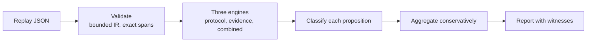

## A judge can be right for the wrong reasons

An LLM judge reads a response and returns a verdict, usually paired with a rationale.
Increasingly, those verdicts gate real decisions: whether an answer ships, an agent's
next step is accepted, or a model gets promoted.

When we evaluate a judge, we usually just ask: _did it get the right answer?_ If
we have a gold label, that's easy to check. But we don't just give a judge a
question; we also give it a set of rules (i.e., a protocol) for how to reach its
verdict. Something like:

> Identify every factual claim. Check each one against only the supplied context.
  Do not use outside knowledge. PASS if and only if every claim is supported.

Whether the judge followed that protocol is a different question from whether its
verdict matched the gold label, and the two come apart in ways that matter.

To see how, consider four test cases from my test suite. In each one, a judge is
evaluating the same response: _"Alice joined ACME in 2024 and is its CTO."_ In
case A, the supplied context confirms both claims, so the response should pass.
In cases B, C, and D, the context only says _"Alice joined ACME in 2024,"_
leaving the CTO claim unsupported, so the response should fail.

| Case | Verdict correct? | Procedure followed? | Rationale supports its verdict? | Claims grounded in context? | Overall |
| --- | --- | --- | --- | --- | --- |
| A | yes | yes | yes | yes | satisfied |
| B | yes | **no** | yes | yes | violated |
| C | **no** | yes | yes | **no** | violated |
| D | **no** | **no** | **no** | yes | violated |

In Case B, the judge gets the right answer, but only by breaking the rules. Its
rationale admits: _"I also checked my outside knowledge to confirm this first
claim,"_ which the protocol explicitly forbids. A simple gold-label check would
mark this judge as correct, whereas a procedural audit catches the violation.

Case C is the opposite, and it's the more worrying failure mode. Here, the judge
follows every step of the protocol, and its verdict follows logically from its
rationale. The problem is that it claims the context supports the CTO role when
the text says nothing of the sort. The judge is internally consistent, yet
completely wrong, and the only way to catch the error is to check its claims
against an independent reading of the context.

Case D combines both failures. Its rationale says the context does not support
Alice's title, then draws on outside knowledge to return PASS anyway. It
contradicts itself and breaks the protocol.

> Correctness asks whether the judge landed in the right place. Adherence asks
  whether it got there the way it said it would.

[Unmask](https://github.com/hsanchez/unmask)'s adherence check is built to tell those apart.

## What goes in: a replay, not a vibe

To understand what Unmask's output means, it helps to be clear about what goes in.
Unmask doesn't just read a judge's rationale and decide whether it sounds careful.
Instead, it checks a **structured replay** of the evaluation, which consists of five
parts:

- **The protocol**, translated into Boolean _atoms_. Each atom has one of three roles:
  a `judge` atom represents something the judge asserts (e.g., "the context supports
  claim 2"), a `context` atom captures an independent observation about the source
  material, and a `procedure` atom records an observable step (e.g., "the judge
  consulted outside knowledge").
- **A decision expression** over those atoms that defines the verdict. In our four
  test cases, for example, `PASS` holds if and only if both claims are supported.
- **Requirements** the judge must follow, each defined by a Boolean expression and
  an optional _coverage_ expression indicating whether the requirement was observable
  in the first place.
- **Annotations** that assign each atom a value of `TRUE`, `FALSE`, or `UNKNOWN`,
  backed by exact evidence spans quoted from the source text.
- **Grounding pairs** that link each of the judge's claims (`judge` atoms) to the
  corresponding independent observation (`context` atoms).

To make this concrete, here is how Case B encodes the "use only supplied context"
requirement alongside the annotation that violates it, trimmed from the actual
fixture:

```json
{
  "id": "context_only",
  "description": "Use only supplied context",
  "expr": {"op": "not", "args": [{"atom": "external"}]},
  "addressed": {"const": true}
}
```

```json
{
  "atom": "external",
  "value": "TRUE",
  "evidence": [{
    "source": "rationale",
    "start": 0,
    "end": 182,
    "quote": "There are two claims. Joining ACME in 2024 is supported. I also checked my outside knowledge to confirm this first claim. ..."
  }],
  "explanation": "Rationale explicitly relies on external knowledge. Hand-annotated semantic assessment; span validity does not prove interpretation."
}
```

The annotations in these fixtures were written by hand, which is a real limitation
that I'll return to below. For now, though, notice what this design buys us: instead
of having another model silently re-derive semantic judgments inside the checker,
those judgments are surfaced as explicit, quotable facts. A reviewer can look at
`external = TRUE`, read the attached quote, and decide for themselves whether they
agree.

The pipeline:



## Principle 1: unknown is not false

Real evaluations are rarely complete. For instance, a rationale might never mention
whether the judge used outside knowledge. If we silently treated "not mentioned" as
`FALSE`, we would end up crediting judges for rules we never actually saw them follow.

Instead, an annotation can be marked as `UNKNOWN`. In the solver, an `UNKNOWN` atom
asserts **nothing**: its value is left completely unconstrained. When the solver
produces a witness, it fills in these unpinned atoms with plausible values, and the
final report explicitly flags those completions as possibilities rather than
observations.

This design has a nice side effect: we get a form of three-valued reasoning from a
standard Boolean solver, with no custom logic. A claim is entailed if it holds
however the unknown atoms are filled in, refuted if it fails however they are
filled in, and underdetermined otherwise. For a decision over two atoms where one
is `UNKNOWN`, the solver produces the following results:

| Expression | Known atom | Other atom | Result |
| --- | --- | --- | --- |
| A or B | A true | unknown | entailed |
| A and B | A true | unknown | underdetermined |
| A and B | A false | unknown | refuted |
| A implies B | A false | unknown | entailed |
| A or B | A false | unknown | underdetermined |

As expected, a false conjunct or a true disjunct settles the outcome regardless of
the unknown value, while everything else remains underdetermined.

This is not Kleene's three-valued logic. If $$A$$ is unknown, Kleene's logic calls
$$A\vee\neg A$$ unknown, while here it is entailed, because it holds however $$A$$
is filled in. Because intuition around three-valued logic is easy to get subtly
wrong, I verified this behavior against exhaustive truth tables across 150
randomly generated formulas.

## Principle 2: check satisfiability before entailment

Using a solver to check whether a conclusion follows from a set of facts comes with a
classic trap: if those facts are contradictory, _everything_ follows from them
(the principle of explosion). A checker that simply reports "entailed" in that
situation is technically, and uselessly, correct.

To avoid this, Unmask first verifies that the underlying base of facts is actually
consistent before checking for entailment. And rather than testing a single combined
base, it builds three separate ones:

$$
B_{\text{proto}}=K\wedge(V\Leftrightarrow D),\qquad
B_{\text{evid}}=F,\qquad
B_{\text{all}}=B_{\text{proto}}\wedge F.
$$

Here $$K$$ are the protocol's constraints, $$D$$ is the decision expression, $$V$$
is the verdict variable, and $$F$$ is the set of facts from non-UNKNOWN annotations.
The annotations $$\mathcal{N}$$ are indexed by atom $$\alpha$$, $$x_\alpha$$ is the
Boolean variable for that atom, and $$\mathrm{value}_\alpha$$ is its annotated
value:

$$
F=\{\,x_\alpha\Leftrightarrow(\mathrm{value}_\alpha=\mathrm{TRUE})\ :\ \alpha\in\mathcal{N},\ \mathrm{value}_\alpha\neq\mathrm{UNKNOWN}\,\}.
$$

Why three? Because each one pinpoints a different kind of failure. If
$$B_{\text{proto}}$$ is unsatisfiable, the protocol contradicts itself. If
$$B_{\text{evid}}$$ is unsatisfiable, the annotations contradict each other. And if
both are fine on their own, yet $$B_{\text{all}}$$ is unsatisfiable, the evidence
conflicts with the protocol. Separating them lets the report distinguish between
"your protocol is broken," "your annotations are broken," and "your judge's claims
violate the protocol."

Keeping these bases separate also lets us run the requirement and grounding checks
against $$B_{\text{evid}}$$ alone, ensuring that a contradictory protocol can never
poison what the evidence directly shows.

## Principle 3: two queries classify any claim

Given a satisfiable base $$B$$ and a proposition $$\varphi$$, two satisfiability
checks classify it:

$$
\mathrm{status}(\varphi)=\begin{cases}
\text{ENTAILED} & B\wedge\neg\varphi\ \text{is unsatisfiable},\\
\text{REFUTED} & B\wedge\varphi\ \text{is unsatisfiable},\\
\text{UNDERDETERMINED} & \text{otherwise.}
\end{cases}
$$

A fourth outcome, `SOLVER_UNKNOWN`, handles solver timeouts, ensuring the status is
never silently guessed.

`UNDERDETERMINED` means the facts are consistent with both $$\varphi$$ and its
negation. A verdict can be perfectly compatible with a rationale without being
_forced_ by it, and the report keeps those apart: merely compatible is not the
same as entailed.

```algorithm
\begin{algorithm}
\caption{Classify a proposition against a base}
\begin{algorithmic}
\PROCEDURE{Classify}{$B, \varphi$}
    \IF{$B$ is unsatisfiable}
        \RETURN inconsistent base
    \ENDIF
    \STATE $t \gets$ \CALL{Check}{$B \wedge \varphi$}
    \STATE $f \gets$ \CALL{Check}{$B \wedge \neg\varphi$}
    \IF{$t$ or $f$ timed out}
        \RETURN solver unknown
    \ELIF{$f$ is unsatisfiable}
        \RETURN entailed
    \ELIF{$t$ is unsatisfiable}
        \RETURN refuted
    \ELSE
        \RETURN underdetermined, with a witness for each side
    \ENDIF
\ENDPROCEDURE
\end{algorithmic}
\end{algorithm}
```

## Principle 4: keep the dimensions apart, and aggregate cautiously

Because a judge can fail along several independent axes, collapsing everything into a
single score hides what actually went wrong. Instead, Unmask reports four dimensions
separately:

- **Verdict entailment**: does the stated rationale force, merely allow, or
  contradict the observed verdict?
- **Procedural compliance**: was each requirement actually met?
- **Coverage**: was the requirement observable in the first place? A requirement
  that no one can see being satisfied is very different from one that was actively
  violated.
- **Grounding**: do the judge's claims match independent observations of the
  context?

Of these, I find coverage the most useful in practice. "We couldn't tell whether the
judge used outside knowledge" and "the judge used outside knowledge" are
different findings, and an audit shouldn't flatten both into a pass or
both into a failure.

When it comes time to roll these individual checks up into an overall result, Unmask
uses a deliberately conservative rule. Given statuses $$s_1,\dots,s_k$$:

$$
\mathrm{agg}(s_1,\dots,s_k)=\begin{cases}
\text{VIOLATED} & \exists i:\ s_i=\text{REFUTED},\\
\text{SATISFIED} & k>0\ \wedge\ \forall i:\ s_i=\text{ENTAILED},\\
\text{UNKNOWN} & \text{otherwise.}
\end{cases}
$$

Two further rules apply. First, if a replay supplies
no requirements or no grounding pairs, the overall result can never be `SATISFIED`: you
don't get credit for a dimension that was never checked. Second, any base
inconsistency or solver timeout automatically forces the overall result to `UNKNOWN`.

The whole procedure, in one place:

```algorithm
\begin{algorithm}
\caption{Check protocol adherence of a replay}
\begin{algorithmic}
\REQUIRE Constraints $K$, decision $D$, requirements $Q$ (each with expression $q$ and optional coverage $a$), annotations $\mathcal{N}$, observed verdict $v$, grounding pairs $\Pi$
\ENSURE A status, a result per dimension, and witnesses
\IF{translation status is not valid}
    \RETURN overall UNKNOWN
\ENDIF
\STATE $F \gets \{\, x_\alpha \Leftrightarrow (\mathrm{value}_\alpha = \mathrm{TRUE}) : \alpha \in \mathcal{N},\ \mathrm{value}_\alpha \neq \mathrm{UNKNOWN} \,\}$
\STATE $B_{\mathrm{proto}} \gets K \wedge (V \Leftrightarrow D)$
\STATE $B_{\mathrm{evid}} \gets F$
\STATE $B_{\mathrm{all}} \gets B_{\mathrm{proto}} \wedge F$
\STATE $\varphi_v \gets V$ if $v = \mathrm{PASS}$, otherwise $\neg V$
\STATE $s_{\mathrm{verdict}} \gets$ \CALL{Classify}{$B_{\mathrm{all}}, \varphi_v$}
\FORALL{$(q, a) \in Q$}
    \STATE $s_q \gets$ \CALL{Classify}{$B_{\mathrm{evid}}, q$}
    \STATE $s_a \gets$ \CALL{Classify}{$B_{\mathrm{evid}}, a$} if $a$ is given, otherwise not specified
\ENDFOR
\FORALL{$(j, c) \in \Pi$}
    \STATE $s_{jc} \gets$ \CALL{Classify}{$B_{\mathrm{evid}}, x_j \Leftrightarrow x_c$}
\ENDFOR
\STATE $\mathit{overall} \gets \mathrm{agg}(\text{all statuses})$
\IF{$Q = \emptyset$ or $\Pi = \emptyset$}
    \STATE $\mathit{overall} \gets \mathrm{agg}(\mathit{overall}, \mathrm{UNKNOWN})$
\ENDIF
\IF{$B_{\mathrm{proto}}$, $B_{\mathrm{evid}}$ or $B_{\mathrm{all}}$ is inconsistent, or any query timed out}
    \STATE $\mathit{overall} \gets \mathrm{UNKNOWN}$ and report which base failed
\ENDIF
\RETURN statuses, $\mathit{overall}$, and the violated checks with their evidence
\end{algorithmic}
\end{algorithm}
```

## Two things that never enter the solver

Two validation rules apply before the solver even runs.

**The gold label stays out.** While the final report notes whether the verdict
matches the gold label, that label never enters the solver. In fact, there is an
explicit test for this: if you flip the gold label, the resulting report must
remain identical apart from the two gold-derived fields. If the gold label
leaked into the solver, an audit could end up rationalizing an answer it had
already been given.

**Evidence must be a real quote.** Every non-`UNKNOWN` annotation must point to
an exact Unicode code-point span in the source text, and the quoted string must
match that span verbatim. The validator also rejects spans taken from the wrong
source for a given atom's role. For instance, you cannot quote the protocol text
as evidence that the judge actually performed a step. A span check
verifies that a _quotation_ is real, not that it _means_ what the annotator claims
it means.

## How is this different from verifying instruction following?

A closely related piece of recent work is "Neuro-Symbolic Verification on
Instruction Following of LLMs" (NSVIF, Su et al., [arXiv:2601.17789](https://arxiv.org/abs/2601.17789)). Like Unmask, NSVIF
uses Z3, separates logical structure from semantics, and aims to produce
interpretable feedback. It frames instruction following as a
constraint-satisfaction problem: a model extracts constraints from the
instruction and writes a Z3 program to compose them, using model-generated code
to check logical constraints and an LLM to judge semantic ones before Z3
combines everything into a final `SAT` or `UNSAT` result.

Despite the shared machinery, the two systems ask different
questions:

- **NSVIF** asks: _did this output follow the instruction it was given?_
- **Unmask** asks: _did this judge follow the protocol it was meant to apply when evaluating something?_

Because the questions differ, the inputs do too. In NSVIF, the subject under
test is a single model output, and the constraints come directly from a prompt.
Here, the subject is an entire evaluation process, and what matters is the
three-way relationship between the judge's stated claims, an independent reading
of the source material, and the final verdict.

They also differ in where the semantic judgment lives. NSVIF automates both
constraint extraction and semantic evaluation: a model judges each semantic
constraint, and any violation is explained through that model's response and
reasoning trace. Unmask, by contrast, turns each semantic judgment into an
explicit, annotated fact backed by an exact evidence span. This trades
automation for inspectability: you can see the exact semantic claim a conclusion
rests on, and the final report makes it clear that its conclusions are
conditional on those annotations.

Because of this, I see the two approaches as complementary rather than
competing. A natural next step would be to use an automated semantic checker
like NSVIF's to _produce_ the annotations that Unmask then reasons over. For
now, though, that remains a hypothesis: the only automation I have built so far
is an experimental, model-assisted proposer for a single fixed protocol, and I
have not yet measured its accuracy.

## What this does not do

- **It does not read prose on its own.** Both the protocol translation and the
  annotations must be supplied upfront. For one fixed protocol (factual claims),
  an experimental assistant can use a model to propose annotations, though these
  are flagged as unreviewed model output and I have not yet measured their
  accuracy. Any other protocol still has to be translated by hand.
- **The guarantee is conditional.** Every conclusion holds only relative to the
  supplied formalization and annotations. Z3 verifies the structured
  interpretation rather than the raw text or any hidden reasoning the judge may
  have done.
- **Hand annotation does not scale.** The fixtures in this post were annotated by
  hand. While the experimental assistant helps with one specific protocol, the
  broader value of this design depends on getting reliable annotations cheaply,
  which remains an open problem.
- **There is no empirical evaluation yet.** While the four test cases show that
  the checker behaves as designed, I have not yet measured how well annotated
  replays catch real-world judge failures in the wild.

## The question I think comes next

What I find most interesting about this framing is the separation itself.
Correctness, procedure, coverage, and grounding are distinct properties, yet a
gold-label evaluation only ever sees the first.

> If we audited our judges the way we audit our code, which of those four
  dimensions would we see failing first?

My guess is grounding, a failure mode that remains largely invisible to the
metrics we rely on today. That is a hypothesis, not a finding.
